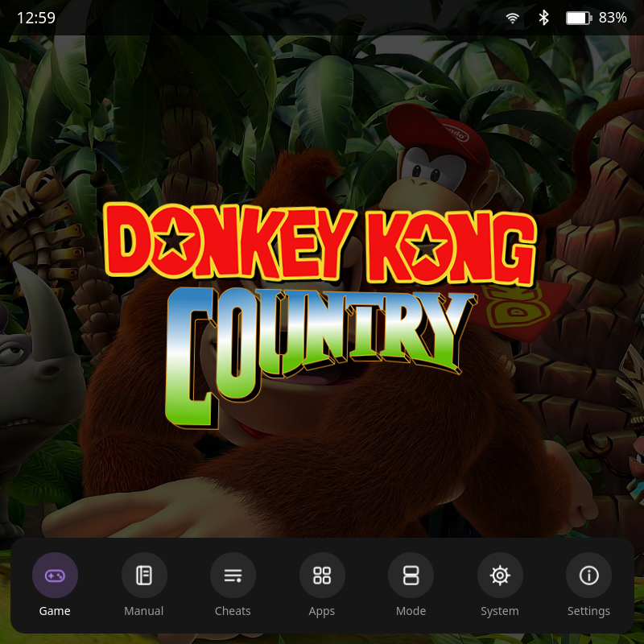
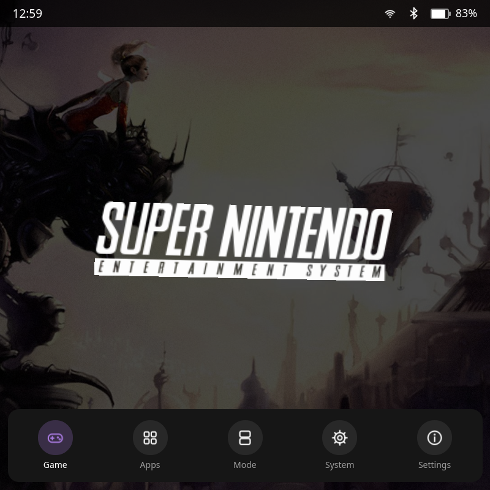
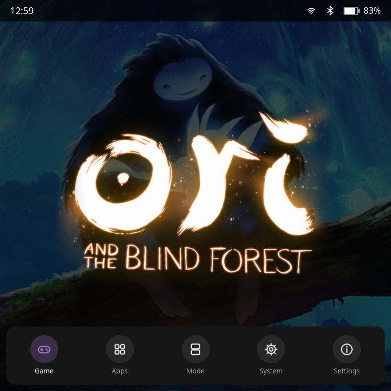
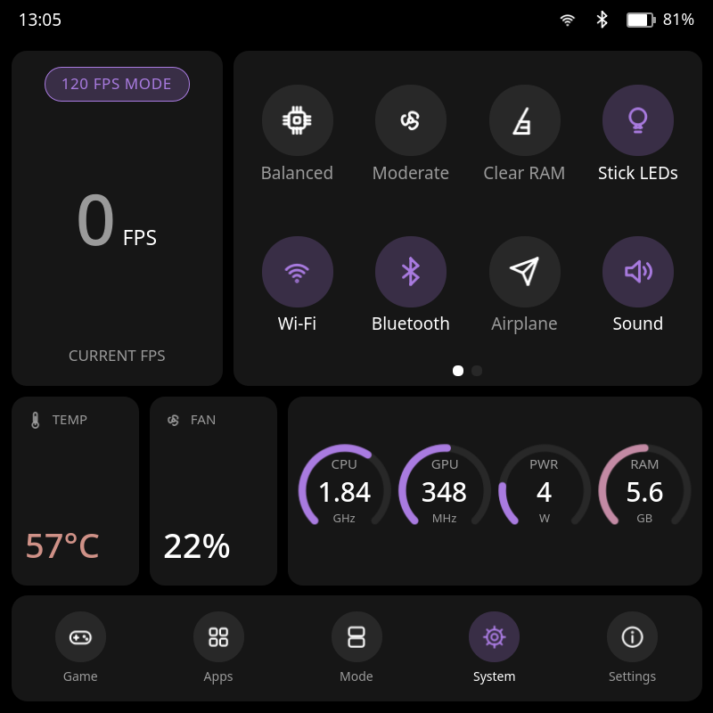
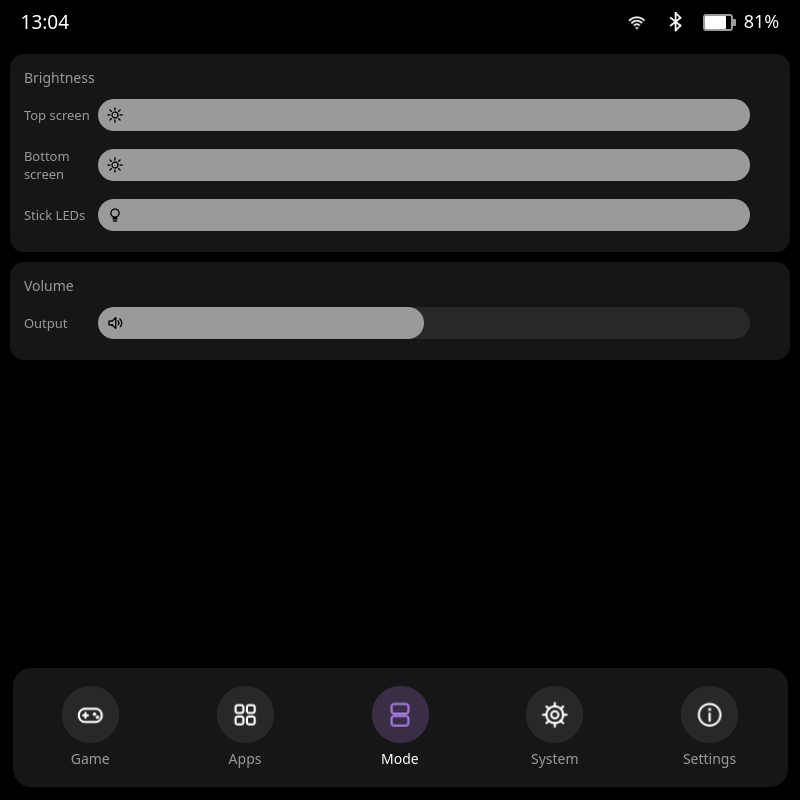
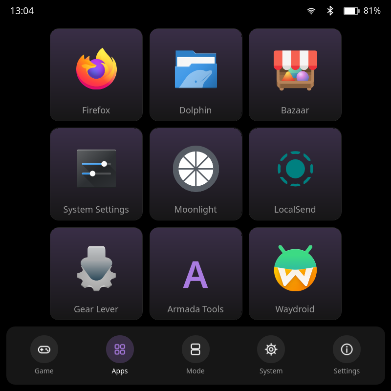
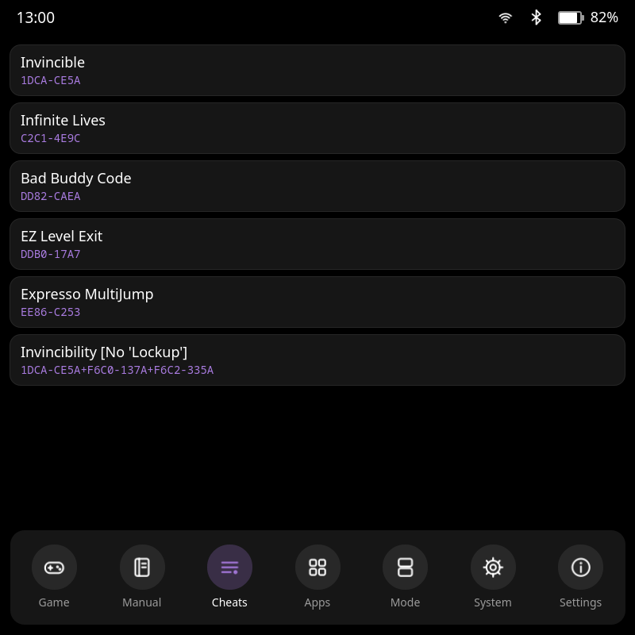
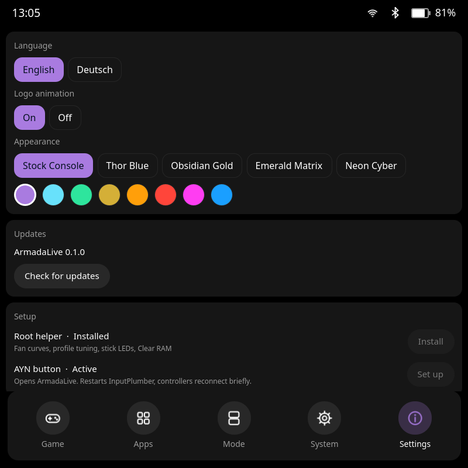
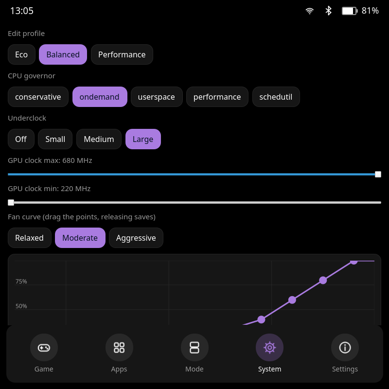

# ArmadaLive

**A companion app for the AYN Thor's bottom screen on [Armada OS](https://github.com/armada-os/armada)**, for **ES-DE** and
**Steam / Big Picture**.

Whatever you scroll through or play on the top screen, the bottom screen shows it: the game's logo and background, its manual
and cheats. Next to that it holds the Thor's controls: power profiles, fan curves, brightness, volume, quick settings and an app
grid. It is a native Qt app that runs full screen in the bottom Plasma session, never draws over your game, and the AYN button
always brings it to the front.

## The goal

On AYN's Android version of the Thor the bottom screen is a dual-screen assistant: it shows the game that is running, and next to it
a panel of quick settings, FPS, temperature and power controls. On Armada OS there was nothing like it, so the second screen sat
unused. **ArmadaLive brings that dual-screen experience to Armada OS**: the running game on the bottom screen (with its logo and
background, from ES-DE or Steam) and the quick settings beside it.

It is an independent re-creation that follows the idea and the look of the Android app. It uses none of its code or assets.

| ES-DE: a game | ES-DE: a system | Steam: highlighted in Big Picture |
|---|---|---|
|  |  |  |

| System | Mode | Apps |
|---|---|---|
|  |  |  |

| Cheats | Settings | Tuning |
|---|---|---|
|  |  |  |

Screenshots were taken on the author's own Thor. The game artwork in them comes from his ES-DE collection and Steam library and
belongs to its owners; ArmadaLive does not ship any of it.

> **Not affiliated.** ArmadaLive is an independent project. It is not made, endorsed or supported by AYN, the Armada OS
> project, Valve, ES-DE or anyone else mentioned here. See [CREDITS.md](CREDITS.md).
>
> **Made with AI.** A large part of this code was written by an AI assistant (Claude Code). Read
> [AI_DISCLOSURE.md](AI_DISCLOSURE.md) before you install it, especially the optional root helper.

## What it does

- **Game** – the game in front, with logo and background. The logo moves gently (it can be switched off in Settings), and
  the picture cross-fades when the game changes. It knows about
  - the game ES-DE has selected or started,
  - emulators that are running (it looks for the ROM they were started with: RetroArch, Eden, Azahar, Cemu, ARMSX2, Dolphin,
    PPSSPP, RPCS3, xemu, DuckStation, Vita3K and more),
  - Steam games, and the app you are highlighting in Steam Big Picture.

  Artwork comes from ES-DE's `downloaded_media` (so scrape once in ES-DE) and from Steam's own library cache.
  This page is full screen; **swipe up** to show the status line and the bar, swipe down to hide them again.
- **Manual** and **Cheats** – the game's PDF manual from ES-DE's media, and cheats from your RetroArch cheats folder. These two
  entries only appear in the bar when the current game has them.
- **Apps** – a 3×3 grid of apps you choose (press and hold, or tap an empty tile). They open on the bottom screen.
  The grid also shows on the Game page when nothing is running.
- **Mode** – brightness of both screens and the stick LEDs, volume.
- **System** – FPS, a 60/120 FPS limit, quick settings (power profile, fan curve, clear RAM, stick LEDs, Wi-Fi, Bluetooth,
  airplane mode, sound, screenshot, GPU clock, screen off), temperature, fan, and gauges for CPU, GPU, power and RAM. The status line
  shows the battery time left. Two tiles open **Graphs** (FPS, CPU, temperature, power and battery over the last two minutes) and
  **Tuning**. Two more, *Game rule* and *System rule*, remember the current power profile and FPS limit for the game in front, or for
  its whole system, and apply them the next time that game starts.
- **Tuning** – reached from the *Tuning* tile on System: CPU governor, underclock, GPU limits and a draggable fan-curve
  editor for each power profile. Needs the root helper.
- **Settings** – a health check (what is missing so that ArmadaLive can see your games, with a hint for each), English or German, ten themes (SteamOS, SNES, Game Boy, PS2, Famicom and more) with accent colours, logo animation on or off, in-app updates, and **Setup**: install the
  root helper and route the AYN button with one tap each (password prompt, greyed out once done). About and AI disclosure.

## Requirements

- An AYN Thor running Armada OS. Developed and tested on build `20261010`.
- Nothing to install from a package manager: Qt for Python (PySide6), `armada-power`, `armada-rgb`, `nmcli`, `rfkill`,
  `wpctl` and `spectacle` are part of Armada OS.
- Optional: [ES-DE](https://es-de.org) with scraped media, for logos and backgrounds of emulated games.

## Install

Open a terminal on the Thor (Konsole, or SSH) and run:

```sh
curl -L https://github.com/FabianZettl/armadalive/releases/latest/download/armadalive.tar.gz | tar xz
cd armadalive
./install.sh
```

That installs ArmadaLive for your user only, no root needed, and starts it. It runs as a user service, starts at login and
adds an **ArmadaLive** entry to the app menu.

**Then open ArmadaLive → Settings → Setup.** The *root helper* (fan curves, profile tuning, stick LEDs, *Clear RAM*) and the *AYN button*
are installed and activated right there: tap *Install* or *Set up*, type your password, done. You do not need a terminal for this.

### Optional steps

Steps 2 and 3 are the two buttons under **Settings → Setup** in the app. Each asks for your password, passes it to `sudo` and
nothing else, and greys out once it is done. The terminal commands below do the same thing and are listed for SSH users.

1. **ES-DE events.** In ES-DE press START, open *Other Settings* and turn on **Custom Event Scripts** and **Browsing Custom
   Event Scripts**, then leave the menu so ES-DE saves. `install.sh` has already put its hooks in `~/ES-DE/scripts`.
   Without this, ArmadaLive still sees running emulators and Steam, but not what you scroll through in ES-DE.
2. **AYN button opens ArmadaLive** (*Setup → AYN button*, or `sudo ~/.local/share/armadalive/scripts/ayn-button.sh`).
   This adds a copy of InputPlumber's AYN capability map under `/etc/inputplumber` and restarts InputPlumber, so the
   controllers reconnect for a moment. The override lives in `/etc`, so after an OS rollback run it again. Undo with `--remove`.
   It is the same override ThorHUD uses.
3. **Root helper** for fan curves, profile tuning, stick LEDs and *Clear RAM* (*Setup → Root helper*, or
   `sudo ~/.local/share/armadalive/scripts/install-helper.sh`). This installs `/etc/armadalive/armadalive-helper` and a sudoers
   rule that lets *your user* run that one program without a password. The helper accepts only a short list of actions and checks
   every value (known governors, real GPU steps, temperature and PWM ranges, colours). It is about 170 lines; read it. Undo with
   `--remove`. After an update that changes the helper, Setup shows *Needs update*.
4. **Highlighted app in Steam Big Picture.** ArmadaLive reads which app is highlighted from Steam's own browser through its
   local debug port. Steam only opens that port while `~/.steam/steam/.cef-enable-remote-debugging` exists; Decky Loader
   creates it. Without it, ArmadaLive still follows Steam games that are running.

### Update and uninstall

- **Update:** *Settings* → *Check for updates* → *Install update*. It downloads the newest GitHub release and runs its
  `install.sh`. The root helper is a separate copy: if a release changes it, *Setup* shows *Needs update* and you tap *Update*.
- **Uninstall:** `./install.sh --uninstall`, plus `sudo scripts/install-helper.sh --remove` and
  `sudo scripts/ayn-button.sh --remove` if you installed those.

## Using it

| | |
|---|---|
| Swipe left or right | next or previous page (not while you drag a slider, the fan curve or the quick-setting pages) |
| Swipe up on *Game* | show the status line and the bar for three seconds |
| Leave it alone for 10 s | the screen dims a little; a touch, or a new game or logo, brightens it (can be switched off in Settings) |
| AYN button | bring ArmadaLive to the front, always |
| Press and hold an app tile | choose another app for that slot |
| Hold a tile on *System* | move tiles: tap a second tile to swap the two (also across the two pages), *Done* to finish, *Reset* for the original order; the order is saved |
| Hold the AYN button | screen off (black, touches ignored); press the button again, or hold a finger on the screen, to wake it |
| Tap the *120 FPS MODE* pill | switch the frame limit between 60 and 120 |
| *Settings → Setup* | install the root helper and route the AYN button, no terminal needed |

Settings are stored in `~/.config/armadalive/` (`ui.json`, `apps.json`).

## How it works

- `scripts/esde-event.py` is linked into ES-DE's event folders and writes the latest event to
  `/run/user/<uid>/armadalive/state.json`.
- The app (`armadalive/`, Python and QML) combines that file with a scan of running emulators, gamescope's focused app and
  stats pipe, and Steam's UI selection.
- Power profiles come from `armada-power`, brightness from logind, radios and volume from `nmcli`, `rfkill` and `wpctl`.
- Things that need root go through the helper above and nothing else.

## Known limits

Honest list of what has *not* been verified or does not work yet:

- The **60/120 FPS pill** sets gamescope's frame limit. The panel's refresh rate stays at 120 Hz.
- Which **brightness slider belongs to which screen** is an assumption (DSI-1 is the bottom panel, DSI-2 the top one).
  If they are swapped, set `ARMADALIVE_BOTTOM_BACKLIGHT` and `ARMADALIVE_TOP_BACKLIGHT` in the service.
- The **Wi-Fi, Bluetooth and airplane** tiles were not switched during development (that would cut the SSH link).
- Staying **full screen** relies on Plasma Mobile hiding its panels; its swipe-up gesture should bring them back.
- **Steam Big Picture selection** depends on Steam's internals and can break with a Steam update.
- A window that you close is only hidden; the AYN button brings it back. This path has not been tried on hardware.
- No screen-mode switching (dual, top only, bottom only, swap): not needed here and not implemented.
- There are no automated tests yet.

## Development

```sh
PYTHONPATH=. QT_QPA_PLATFORM=offscreen QT_QUICK_BACKEND=software \
    python3 -m armadalive --snapshot out.png --page 3 --lang en
```

renders a page to an image (pages: 0 game, 1 apps, 2 mode, 3 system, 4 settings, 5 tuning). The interface is plain QML in
`armadalive/qml`; the English text is the key and German lives in `Tr.qml`.

### Tests and releases

```sh
QT_QPA_PLATFORM=offscreen python3 -m unittest discover -s tests -t . -v
```

runs the tests (a fake ES-DE folder, the root helper against a temp folder, settings, game rules, all QML files, German texts).
GitHub runs them on every push. `scripts/make-release.sh <version> <notes.md>` runs them, builds `armadalive.tar.gz` with its
`.sha256` and publishes the release; the in-app updater checks the download against that checksum and refuses a release without one.

## License

[MIT](LICENSE) © 2026 Fabian Zettl, Stuttgart. Third-party credits: [CREDITS.md](CREDITS.md).
