# ArmadaLive

**The bottom-screen companion for the AYN Thor on [Armada OS](https://github.com/armada-os/armada).** It shows the game you are in
on the lower screen and puts the Thor's controls, your games and your stats within reach of your thumb.

Whatever you scroll through or play on the top screen, the bottom screen follows it: the game's logo and background, its info,
manual and cheats. Next to that it holds the quick settings, an app and game launcher with folders, per-game power rules,
play time statistics, a task manager and trackpads. It is a native Qt app that runs full screen in the bottom Plasma session,
never draws over your game, and the AYN button always brings it to the front.

| ES-DE: a game | ES-DE: a system | Steam: highlighted in Big Picture |
|---|---|---|
| 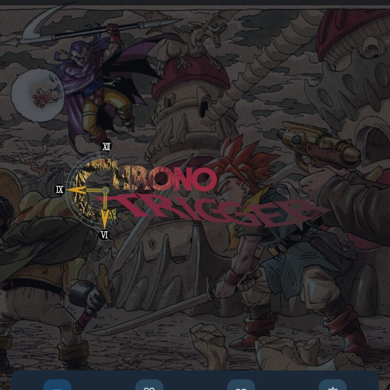 | 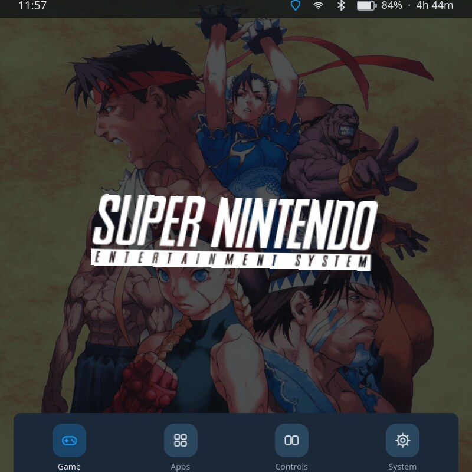 | 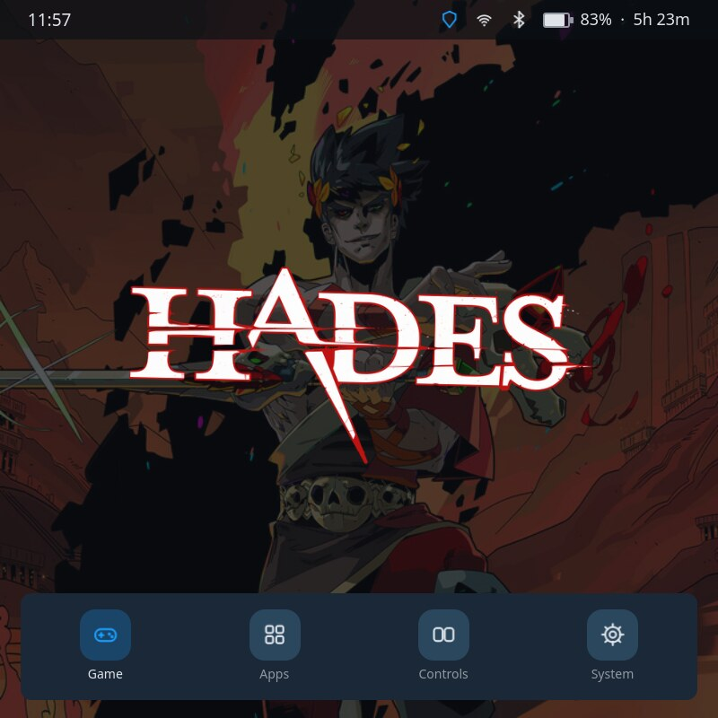 |

| System | Apps | A folder |
|---|---|---|
| 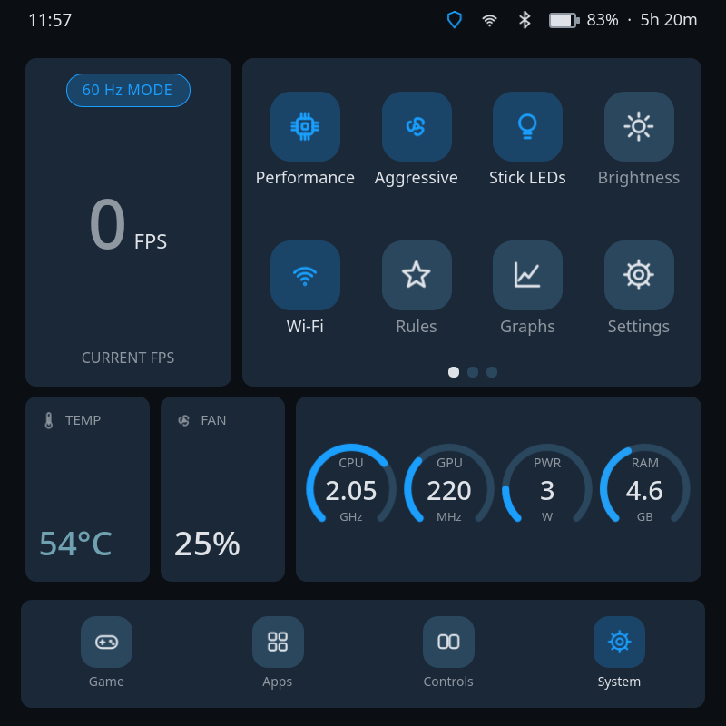 | 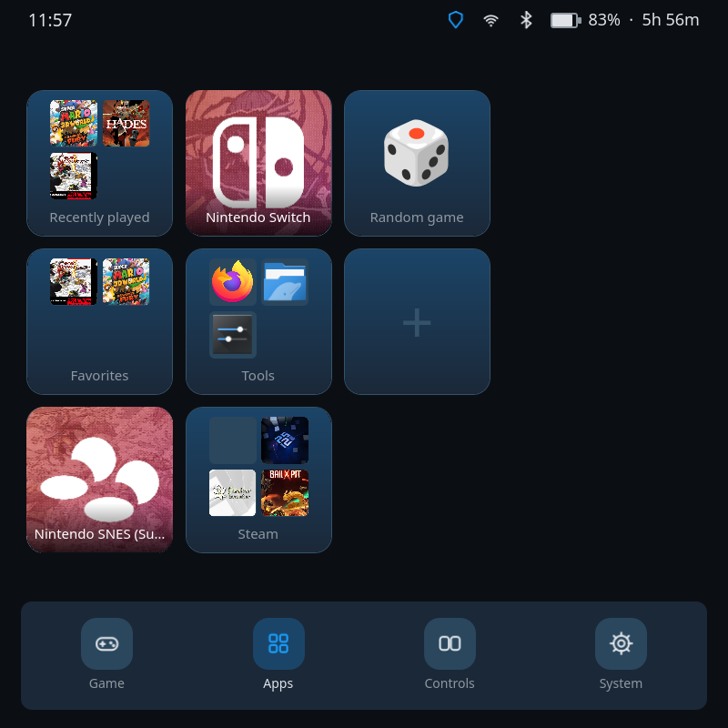 | 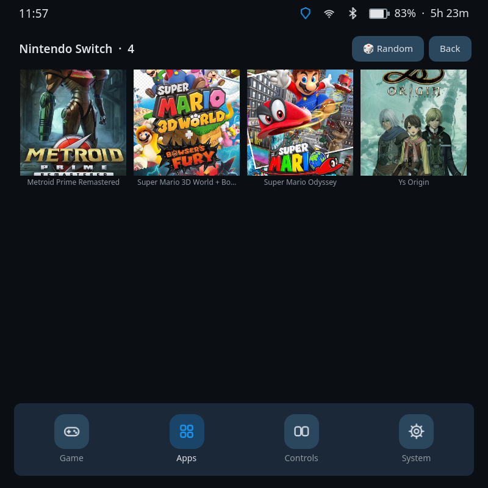 |

| Game info | Play time | Rules |
|---|---|---|
| 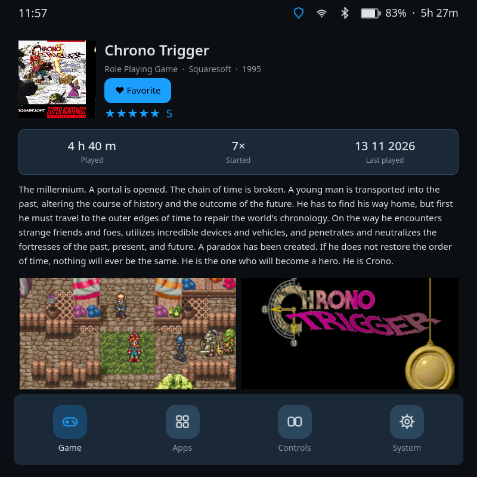 | 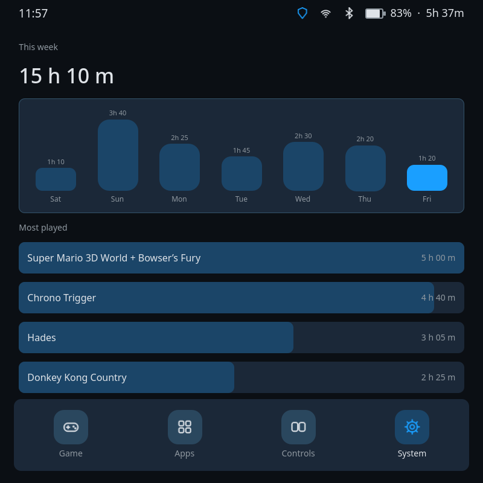 | 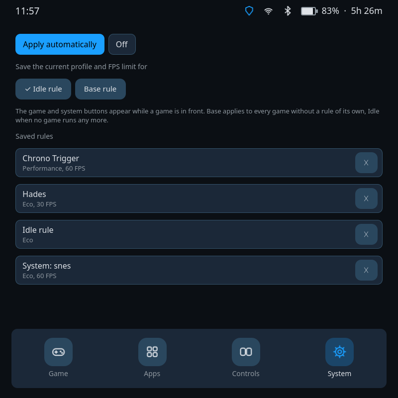 |

| Settings | Themes | First-run setup |
|---|---|---|
| 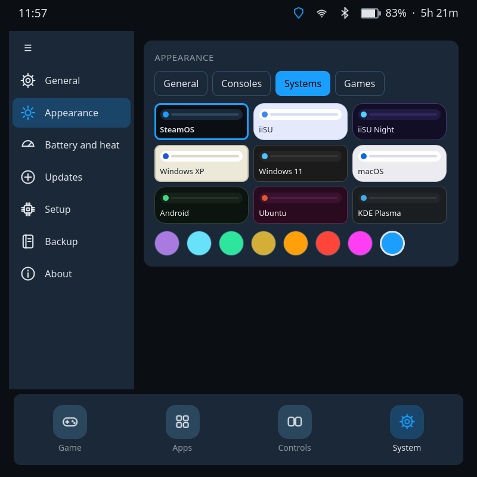 | 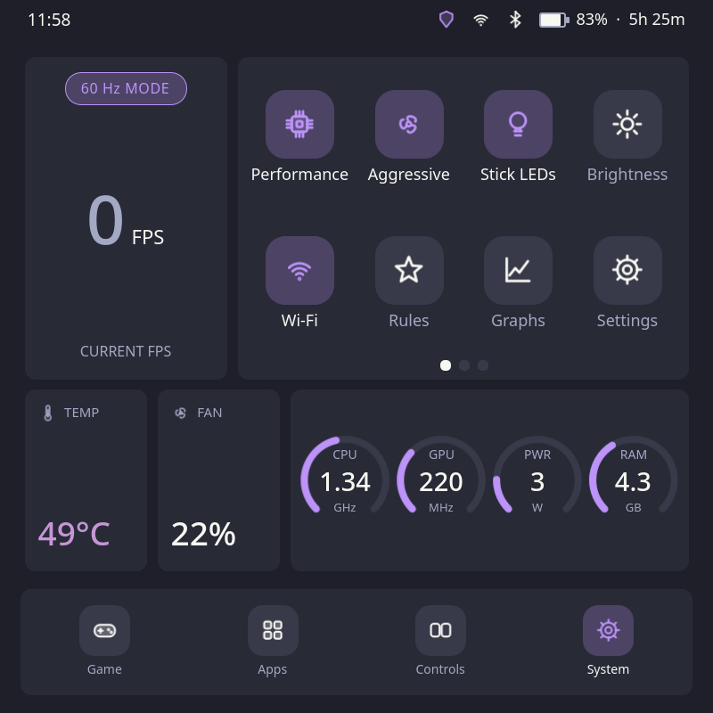 | 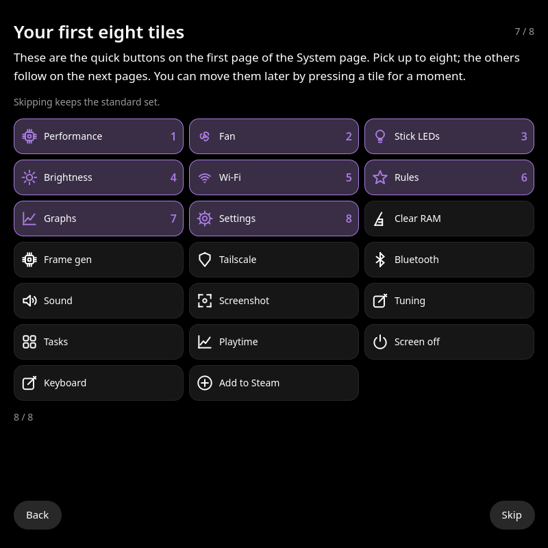 |

Screenshots were taken on the author's own Thor. The game artwork in them comes from his ES-DE collection and Steam library and
belongs to its owners; ArmadaLive does not ship any of it. The play time, folders and rules in the screenshots are sample data.

> **Not affiliated.** ArmadaLive is an independent project. It is not made, endorsed or supported by AYN, the Armada OS
> project, Valve, ES-DE or anyone else mentioned here. It follows the idea and the look of AYN's Android dual-screen app and
> uses none of its code or assets. See [CREDITS.md](CREDITS.md).
>
> **Made with AI.** A large part of this code was written by an AI assistant (Claude Code). Read
> [AI_DISCLOSURE.md](AI_DISCLOSURE.md) before you install it, especially the optional root helper.

## What it does

**The game in front**
- Logo and background of the game ES-DE has selected or started, of emulators that are running (it finds the ROM they were
  started with: RetroArch, Eden, Azahar, Cemu, ARMSX2, Dolphin, PPSSPP, RPCS3, xemu, DuckStation, Vita3K and more), of Steam games,
  of non-Steam shortcuts that are games, of the app you highlight in Steam Big Picture, and of games in the Ludo plugin (RomM).
  Artwork comes from ES-DE's scraped media and Steam's library cache.
- Tap the artwork: **Info**, **Manual** and **Cheats** buttons and your play time appear. *Info* shows the description, genre,
  developer, year, rating, play time, times started, last played and screenshots, from ES-DE or, for Steam games, from Steam's
  store (needs internet once, then it is cached). A heart makes the game a favourite.
- A media bar for whatever plays on the main screen, and a status line with the battery time left. The page is full screen; swipe
  up for the bar.

**Launch things**
- An **Apps** page with a grid of covers that scrolls sideways: desktop apps (they open on the bottom screen), Steam games and
  shortcuts, and ES-DE games, which start on the main screen. The picker has a search and a tab per ES-DE system.
- **Folders**: your own (press and hold, *Add to folder*), plus smart folders that fill themselves: *Recently played*,
  *Favorites*, *Steam* and one per ES-DE system, with the system's picture from your current ES-DE theme. Every folder has a
  *Random* button; a dice tile starts any game.
- **Add to Steam**: puts the game in front into Steam's library as a shortcut, with its ES-DE artwork.

**Control the device** (the System page)
- A card with the live FPS and a **60/120 Hz mode** switch, quick-setting tiles you can rearrange and which scroll in pages: power
  profile, fan curve, stick LEDs (on/off, brightness, colour), brightness of both screens, Wi-Fi, Bluetooth, Tailscale, sound, screenshot,
  clear RAM, frame generation (Eglantine, Eden, TotK), on-screen keyboard, screen off, Tuning, Graphs, Tasks, Playtime, Rules and Settings.
  Temperature, fan and gauges for CPU, GPU, power and RAM.
- **Rules**: remember the power profile and FPS limit (and the render resolution of PPSSPP, Dolphin and ARMSX2) for one game, one
  system, for idle, or as the base for everything else. They are applied when a game starts or the last one ends. The list names
  each game.
- **Tuning**: CPU governor, underclock, GPU limits and a draggable fan-curve editor per power profile, with Cool, Quiet and Fast
  presets. Every change is taken back after 15 seconds unless you keep it, so a bad curve cannot stick.
- **Graphs**: FPS, CPU, temperature, power and battery over the last two minutes.
- **Tasks**: a small task manager for the bottom screen. It lists what is open there with its memory, goes to a window, closes it, or
  ends a program that hangs.
- **Play time**: bars for the last week, the total and your most played games. It counts what runs on the main screen and imports
  the dates and times Steam and ES-DE already have.
- **Controls**: two trackpads, the back buttons L4, L5, R4 and R5 as a second controller to Steam, an Esc button and buttons for the
  running emulator's hotkeys (virtual mouse and pad through `/dev/uinput`).

**Stay out of the way**
- It never draws over the game. It dims itself after 10 seconds, closes a game when you hold Start and Select for two seconds, and
  warns about heat and a low battery. The AYN button brings it to the front or sends it away; holding it switches the screen off.
- **55 themes** in four groups (general, consoles, operating systems and launchers, games), light and dark, from Dracula and Nord to
  Dreamcast, Switch, Windows XP, macOS, Zelda, Mario and Cyberpunk 2077. A theme sets the colours, the shape of buttons and tiles,
  a faint backdrop, how animations feel, the font and the icon style, and the stick LEDs follow its accent. English and German.
- A **first-run setup** that explains what ArmadaLive needs and why, lets you skip what you do not need, and lets you pick a theme and
  your first eight tiles. A health check, in-app updates (checked against a SHA-256) and a one-file **backup** of settings, rules,
  tile order, apps with folders and play history.

## Requirements

- An AYN Thor running Armada OS. Developed on the Preview and Beta images, last on beta `20261109`.
- Nothing to install from a package manager: `armada-power`, `armada-rgb`, `nmcli`, `rfkill`, `wpctl` and `spectacle` are part of
  Armada OS.
- Qt for Python (PySide6) comes with some Armada images but not all (a system update once removed it). `install.sh` checks, and if it is
  missing it creates a private Python environment in `~/.local/share/armadalive/venv` and installs PySide6 and PyMuPDF there (several
  hundred MB, needs internet, once). After a system update that changes Python's version, run `./install.sh` again.
- The bottom screen has to stay switched on in Armada's settings (Decky plugin, *Armada control*): ArmadaLive runs in the bottom Plasma session.
- Optional: [ES-DE](https://es-de.org) with scraped media, for logos, backgrounds and game info of emulated games.

## Install

Open a terminal on the Thor (Konsole, or SSH) and run:

```sh
curl -L https://github.com/FabianZettl/armadalive/releases/latest/download/armadalive.tar.gz | tar xz
cd armadalive
./install.sh
```

That installs ArmadaLive for your user only, no root needed, and starts it. It runs as a user service, starts at login and adds an
**ArmadaLive** entry to the app menu.

**The first start opens the setup.** It walks you through the four things ArmadaLive can use, each with what it is for, a button where
the app can do it for you, and a note on what you lose if you skip it:

1. **Root helper**: fan curves, profile tuning, stick LEDs, clear RAM and the charge-limit attempt. It installs
   `/etc/armadalive/armadalive-helper` and a sudoers rule that lets *your user* run that one program without a password. The helper
   accepts only a short list of actions and checks every value. Read it; it is short. Undo with
   `sudo ~/.local/share/armadalive/scripts/install-helper.sh --remove`.
2. **AYN button opens ArmadaLive**: adds a copy of InputPlumber's AYN capability map under `/etc/inputplumber` and restarts
   InputPlumber, so the controllers reconnect for a moment. The override lives in `/etc`, so after an OS rollback run it again. Undo with
   `sudo ~/.local/share/armadalive/scripts/ayn-button.sh --remove`.
3. **ES-DE**: in ES-DE press START, open *Other Settings* and turn on **Custom Event Scripts** and **Browsing Custom Event
   Scripts**, and scrape media. `install.sh` has already put its hooks in `~/ES-DE/scripts`. Without this, ArmadaLive still sees running
   emulators and Steam, but not what you scroll through in ES-DE.
4. **Steam**: the highlighted app in Big Picture is read through Steam's local debug port. Turn on *CEF Remote Debugging* in Steam's
   developer settings, or install Decky Loader, then restart Steam. Without it, Steam games are still followed while they run.

Then a theme and the first eight tiles of the System page. Everything can be skipped, and it can be started again in
**Settings → Setup → Run setup again**. The password for the first two is typed into the app and passed to `sudo` and nothing else.

### Update and uninstall

- **Update:** *Settings → Updates → Check for updates → Install update*. It downloads the newest GitHub release, checks it against its
  published SHA-256 and runs its `install.sh`. The root helper is a separate copy: if a release changes it, *Setup* shows *Needs update*.
- **Uninstall:** `./install.sh --uninstall`, plus the two `--remove` commands above if you installed those.

## Using it

| | |
|---|---|
| Swipe left or right | next or previous page (not while you drag a slider, the fan curve or the tile pages) |
| Swipe up on *Game* | show the status line and the bar for three seconds |
| Tap the artwork on *Game* | Info, Manual and Cheats, and your play time |
| Tap the *Hz MODE* pill | switch the screen between 60 and 120 Hz (and the frame limit with it) |
| Hold a tile on *System* | move tiles: tap a second tile to swap, *Done* to finish, *Reset* for the standard order |
| Press and hold an app tile | choose another app, game or folder for that slot |
| AYN button | tap: bring ArmadaLive to the front, or send it away if it is in front; hold: screen off |
| Hold Start + Select for 2 s | close the program in front (emulator, ES-DE, Steam game; not Steam itself), with a countdown |
| Leave it alone for 10 s | the screen dims a little; a touch brightens it (can be switched off in Settings) |

Settings are kept in `~/.config/armadalive/`. *Settings → Backup* saves them as one file, `~/ArmadaLive-backup.json`.

## How it works

- `scripts/esde-event.py` is linked into ES-DE's event folders and writes the latest event to `/run/user/<uid>/armadalive/state.json`.
- The app (`armadalive/`, Python and QML) combines that file with a scan of running emulators, gamescope's focused app and stats pipe,
  and Steam's UI selection. Game info comes from ES-DE's gamelists and, for Steam games, from Steam's store.
- Power profiles come from `armada-power`, brightness from logind, radios and volume from `nmcli`, `rfkill` and `wpctl`.
- Things that need root go through the helper above and nothing else.

## Known limits

An honest list of what has *not* been verified or does not work yet:

- **The Hz mode** sets gamescope's dynamic refresh rate and the frame limit. It was accepted by gamescope, but not checked with a
  running game on every setup.
- **The charge limit** does not work on the Thor: the battery controller refuses it. ArmadaLive says so and hides the setting.
- Which **brightness slider belongs to which screen** is an assumption (DSI-1 is the bottom panel, DSI-2 the top one). If they are
  swapped, set `ARMADALIVE_BOTTOM_BACKLIGHT` and `ARMADALIVE_TOP_BACKLIGHT` in the service.
- The **Wi-Fi, Bluetooth and airplane** switches were not used during development (that would cut the SSH link).
- **Steam Big Picture selection** depends on Steam's internals and can break with a Steam update.
- **Close game** reads the controller directly. Emulators that ignore the polite quit are killed after three seconds, unsaved progress
  is lost.
- The **resolution** setting edits the emulators' own config files; Azahar is not supported. Start the game from ES-DE so the file is
  written before the emulator reads it.
- **Folders, the settings menu and the first-run setup** were checked with screenshots and on one Thor, less with every kind of touch.
- **Game info for Steam games** needs an internet connection the first time.

## Development

```sh
PYTHONPATH=. QT_QPA_PLATFORM=offscreen QT_QUICK_BACKEND=software \
    python3 -m armadalive --snapshot out.png --page 2 --lang en
```

renders a page to an image (pages: 0 game, 1 apps, 2 system, 3 settings, 4 tuning, 5 cheats, 6 manual, 7 graphs, 8 controls, 9 tasks,
10 play time, 11 info, 12 rules). `--demo` pins a game, `--theme` and `--lang` set the look, `--click x,y,ms` taps and `--step N`
shows a step of the first-run setup. The interface is plain QML in `armadalive/qml`; the English text is the key and German lives in `Tr.qml`.

```sh
QT_QPA_PLATFORM=offscreen python3 -m unittest discover -s tests -t . -v
```

runs the tests (a fake ES-DE folder, the root helper against a temp folder, settings, rules, folders, all QML files, German
texts). GitHub runs them on every push. `scripts/make-release.sh <version> <notes.md>` runs them, builds `armadalive.tar.gz`
with its `.sha256` and publishes the release; the in-app updater refuses a release without a checksum.

## License

[MIT](LICENSE) © 2026 Fabian Zettl, Stuttgart. Third-party credits: [CREDITS.md](CREDITS.md).
